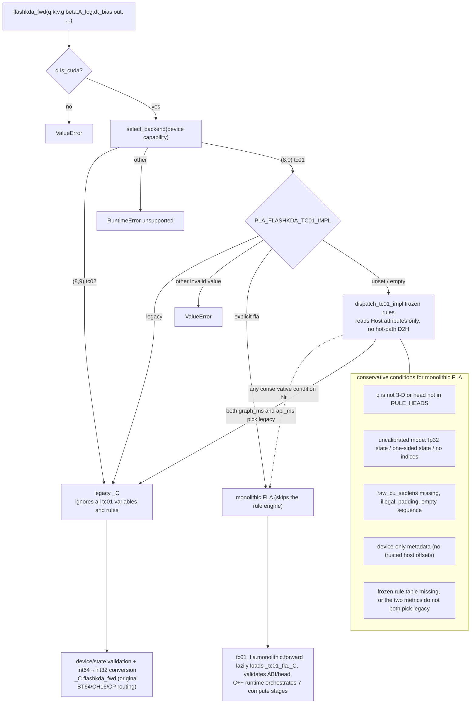

# pla.prefill — PPU1.5 Prefill Kernels

This document covers the two prefill kernel families under `pla.prefill`:

- **FlashQLA** (gated delta rule) → `pla.prefill.flashqla`
- **FlashKDA** (Kimi Delta Attention) → `pla.prefill.flashkdapro`

Each is compiled into its own `.so` with no dependency on the other, but **both share the same ACTLIZE**
(see the "Dependency: actlize" section); each can be built separately with `--namespace`.

The decode side (`pla.decode`, Fused Sigmoid Gating Delta Rule / k_last series) is compiled into
a separate `pla/decode/_C*.so`, independent of prefill; see the top-level `README.md`.

---

## FlashQLA (`pla.prefill.flashqla`)

The FlashQLA PPU1.5 prefill implementation, compiled to `pla/prefill/flashqla/_C*.so` and exposed through
the `pla.prefill.flashqla` namespace. It contains only the 6 production prefill kernels
(the 4 probe kernels are excluded).

### Directory layout

```
src/prefill/flashqla/
  kernels/                     # 6 production kernels + traits (CUDA sources)
    chunk_cumsum_cute.cu
    kkt_solve_cute.cu
    get_warmup_chunks_cute.cu
    prepare_h_cute.cu
    correct_h0_cute.cu
    fused_fwd_cute.cu
    flashqla_cute_traits.cuh   # contains a self-contained PPU_16x16x16 FIXED MMA atom
  host/
    torch_extension_cute.cc    # pybind11 bindings, exposes 6 ops

pla/prefill/flashqla/
  __init__.py                  # public API: chunk_gated_delta_rule_fwd + packed QKV GDN
  ops.py                       # high-level end-to-end forward pipeline
  private/
    __init__.py                # 6 ops + calc_cp_seqs
    cp_preprocess.py           # CP segment preprocessing (pure PyTorch, no extension dependency)

scripts/prefill/flashqla/      # UT scripts
  e2e_acc_full.py              # end-to-end accuracy check over all dispatch shapes + CP + h0
  private/
    run_all_prefill_uts.sh     # UT entry point
    test_raw_gating.py         # raw gating + packed QKV + indexed state
    ref_gdr.py                 # upstream FlashQLA torch reference implementation (verbatim)
    flash_qla/                 # utils shim required by ref_gdr.py
```

### Public interface

Public namespace `pla.prefill.flashqla`:

```python
from pla.prefill.flashqla import chunk_gated_delta_rule_fwd

g_cum, A, o, _, ht = chunk_gated_delta_rule_fwd(
    q, k, v, g, beta, initial_state=initial_state
)
```

`chunk_gated_delta_rule_fwd` chains the complete pipeline internally:

```python
g_cum = chunk_local_cumsum(g, cu_seqlens, chunk_indices)  # CS=32 chunked prefix sum
A     = kkt_solve(k, beta, cu_seqlens, H, chunk_indices)  # WY lower-triangular factor
o, ht = fused_fwd(q, k, v, A, beta, g_cum,         # note: beta comes before g
                  cu_seqlens, cp_seq_map, raw_cu_seqlens,
                  valid_num_tokens, H, Hg, scale, h0)
```

When the framework tail-aligns the token dimension for communication shapes,
`cu_seqlens[-1] <= q.size(1)` is allowed: the op only computes the real tokens covered by `cu_seqlens`, `o`
keeps the physical token dimension, the tail padding is zeroed exactly, and it does not take part in the recurrent state update.

The public namespace also provides `gdn_prefill_packed_qkv_fwd`, which directly accepts the `[T,Q|K|V]`
convolution output and raw GDN gating parameters, avoiding extra Q/K/V split tensors; its return values and
state semantics match `chunk_gated_delta_rule_fwd`. The 6 ops and the CP planner composed by the two entry points
are internal building blocks located in `pla.prefill.flashqla.private`.

### End-to-end validation

```bash
CUDA_VISIBLE_DEVICES=4 \
  bash scripts/prefill/flashqla/private/run_all_prefill_uts.sh
CUDA_VISIBLE_DEVICES=4 \
  python scripts/prefill/flashqla/bench_vs_fla.py \
    --num-v-heads 32 --num-k-heads 16 --seq-lens 10240
```

`e2e_acc_full.py` covers all 16 dispatch groups, CP, h0 and the tail-chunk paths, comparing against a self-contained
fp32 FlashQLA torch reference; `private/test_raw_gating.py` covers raw gating, packed
QKV, indexed state and serial/auto-CP. `bench_vs_fla.py` is the release performance entry; PLA goes through
the public interface, Triton uses the in-repo `private/ref` reference implementation, and both sides use the same raw Q/K, indexed
state pool, slot indices and in-kernel Q/K L2 normalize. Diagnostic scripts for CP, packed, stage
breakdown and hardware probes live in `scripts/prefill/flashqla/private/`.

### Supported dispatch shapes (H, Hg)

The production dispatch table supports 16 groups: `128/16`, `64/16`, `64/8`, `48/16`, `32/16`,
`32/8`, `32/4`, `24/8`, `16/8`, `16/4`, `16/2`, `12/4`, `8/4`, `8/2`,
`6/2`, `4/2`. The public API rejects other shapes before launching any kernel.

Configurations with `Hg = H/2` (the number of V heads H is larger than the number of Q/K heads Hg, with each Q/K head shared by a group of V heads)
are called **GVA (Grouped-Value Attention)**, the opposite direction of GQA.

---

## FlashKDA (`pla.prefill.flashkdapro`)

FlashKDA (Kimi Delta Attention) is exposed through `pla.prefill.flashkdapro.flashkda_fwd`.
Building this namespace keeps the original `_C*.so` and additionally AOT-compiles a single monolithic `_tc01_fla._C` extension.
The monolithic extension contains H=4/6/8/12/16/24/32/48/64/96 specializations plus a generic runtime-head instance; objects are compiled
in head/stage groups and a build manifest is recorded, but the 57 separate per-stage `.so` files are no longer generated. At runtime the wheel does not
depend on experiment directories or external manifests, does no JIT, and never silently falls back to the old implementation on OOM or correctness errors.
The partial-head build probes `PLA_FLA_BUILD_HEADS` / `PLA_FLA_BUILD_ONLY=1` remain available but must not be released as wheels.
`PLA_FLASHKDA_TC01_FLA_RUNTIME` and `PLA_FLASHKDA_FLA_BUILD` are retired; any old values no longer take effect.

### tc01 default backend and rollback

- tc01 (capability 8.0): when `PLA_FLASHKDA_TC01_IMPL` is unset or empty, frozen rules route automatically,
  choosing legacy only when both the `graph_ms` and `api_ms` metrics predict legacy is better. The decision only consumes Host
  attributes with no hot-path D2H; unknown shapes, device-only metadata, uncalibrated inputs or a missing rule table go to monolithic FLA.
  Setting `fla` forces monolithic FLA; setting `legacy` forces the original `_C.flashkda_fwd` (including the original BT64/P1/H4, CH16/CP
  routing). Any other value raises an error. The old BT64/CP/K2 environment variables only apply to `legacy`.
- tc02 (capability 8.9): always uses the original `_C`, never loads the new tc01 extension, and ignores the variables above.
- The new backend uses a native packed grid, with each sequence starting from its own BT64 boundary; the number of compute launches does not grow linearly with N.
  The recurrence uses an FP32 carry, and both public BF16/FP32 states are BF16-rounded at the load and publish boundaries.
  Its numerical boundaries differ from legacy, so bitwise equality is not guaranteed; automatic routing only uses frozen rules and does no online performance probing.
- Before Graph capture, warm up one public call on the target device. With trusted `raw_cu_seqlens`, warm up the same-valued plan on the stream
  used for capture; the caller guarantees it is consistent with the device offsets. Without host offsets,
  int32/int64 metadata is validated and rebuilt on the GPU on every call and replay; illegal device offsets trigger a device trap.
  On the current 810E SDK this is measured to terminate the process at the synchronization point, and conversion into a catchable Python exception is not guaranteed; negative tests need a separate process.
  The caller must guarantee that device offsets are legal and still satisfy this constraint on every Graph replay.
  This path has no hot-path D2H and caches no old values by pointer. All mutable scratch/state/Qg belong to the current call/Graph.

Monolithic FLA on tc01 with N=1 and trusted Host offsets supports BT64 CP.
`PLA_FLASHKDA_TC01_FLA_CP_ALGO=state` selects deterministic state passing, including an actual single segment.
The state path uses BV16 when `4 * heads * actual_segments <= 32`, and BV32 otherwise.
This selects H4/S1-2 and H6/H8/S1; requested splits folded by short inputs use the actual count.
An unset/empty algorithm selects state only in the qualified AUTO buckets below; an explicit split still defaults to legacy.
Explicit `legacy`/`state` overrides retain priority. In particular, H4 AUTO with explicit `legacy` retains serial.
See the [adaptive value-slicing qualification](../profile/tc01-cp-adaptive-bv-20261004/REPORT.md)
and [conditional AUTO qualification](../profile/tc01-remaining-opt-20261005/REPORT.md).
Zero computes segment 0 directly from the public initial state; Transition constructs the middle segments' transforms,
Prefix produces their incoming carries, and the last Correction publishes the final state.
Two segments require three stages; three or more require four. There is no convergence-based exit.
H4 state5 at effective T=12288-65536 is the only multi-segment AUTO bucket; other multi-segment choices remain explicit experiments.

The state path prefetches Correction's existing BF16 output through the otherwise unused V shared-memory slot,
using the same seven AIU groups and waits. Prefix loads each middle-segment transition tile with float4 and publishes
packed BF16 words after the same per-element RN conversion; recurrence/MMA/addition order is unchanged.
These transport changes apply to all shapes routed to state CP for H4/H6/H8/H12, without a case whitelist. The AUTO eligibility is defined separately by the table below.
Correction needs at least two actual segments; the vectorized middle-transition loop needs at least three.
The final combined binary passed a fresh 22,248-case sweep with every saved accuracy metric equal to the preceding
precision-corrected baseline, plus CP, alias, Graph and serial regressions. See the
[CP transport optimization record](../profile/tc01-cp-deepopt-20261002/REPORT.md) for source identity and performance evidence.

The tc01 inter-solve now uses FP32 forward substitution for the 16-token diagonal blocks in both full chunks and tails.
The former TF32 polynomial inverse was unstable for correlated keys with slow decay: it produced large errors at 8K and
NaNs at 32K/64K in the GLM5.3 layer-0/arxiv head-46 case, while an independent FP32 token recurrence stayed finite.
`FLA_INTER_FORCE_FP32_DIAGONAL=0` is retained only as a build-time negative control; the default is `1`.
This is a numerical repair shared by serial and CP, with a measured runtime cost; it does not promise bitwise equality to
older binaries. CP1 must still match serial bitwise within the same binary. The correlated-key device regression compares
both paths against an independent FP32 recurrence. Qg construction also keeps `q * scale` in FP32 until the final BF16
publication (`FLA_QG_FP32_SCALED_Q=1` by default), avoiding an extra intermediate rounding that exceeded the existing
oracle RMS gate in three Kimi-K3 cases. The exact default-source candidate passed all 22,248 records in the real-weight/proxy
sweep, with 57 CP contract checks, 128 state-boundary/alias cases, and 28 extra serial oracle cases. The sweep uses aggregate shard RMS; individual heads
can exceed 1%, and later-layer inputs are embedding-derived proxies rather than captured full-model hidden states.
See [the resolution record](../profile/tc01-cp-resolution-20261001/REPORT.md)
for binary identities, validation results, performance costs, and remaining error limits.

With `PLA_FLASHKDA_TC01_FLA_CP_ALGO` unset/empty:

| head | effective length | AUTO path |
|---:|---:|---|
| H4 | `<128` / `128-2048` / `2049-12287` / `12288-65536` / `>65536` | serial / state CP1 / serial / state CP5 / serial |
| H6 | `<64` / `64-65536` / `65537-102400` | serial / state CP1 / legacy CP1 |
| H8 | `<64` / `64-65536` / `65537-102400` | serial / state CP1 / legacy CP1 |
| H12 | `<8192` / `8192-102400` | serial / legacy CP1 |

`PLA_FLASHKDA_TC01_FLA_CP` unset, empty or `auto` uses this table; `off`/`0` selects serial.
AUTO keeps serial for N>1, other heads, device-only metadata and effective lengths beyond 102400.
Effective length is the trusted host offsets' difference, not the physical tensor extent.
Values `1/2/3/4/5/8` force the corresponding split, requiring N1, trusted offsets, supported heads and effective length <=102400;
otherwise an error is raised. With forced splits and ALGO unset/empty, legacy remains the default.
Explicit ALGO=`state` overrides the algorithm in active buckets; explicit ALGO=`legacy` keeps H4 AUTO serial and H6/H8/H12 legacy CP1.
These are shape rules, not case whitelists. They do not enable CP for every supported workload.
Short L2+gate fusion and the compact BV16/shared-output experiments were not promoted: see the retained negative results in the qualification report.

tc01 routing decision structure (`tests/test_tc01_fla_dispatch.py` is its device-free CPU regression):



The following notes on `_C` internal optimizations and private diagnostic interfaces still apply to legacy/tc02:

> **flashkdapro = flashkda + three structural optimizations** (affine-K1 associativity, register-resident
> DK-split + dedicated-leader K2, split-V/O reduction). The original `flashkda` has been renamed to
> `flashkdapro`; the behavior of the old implementation is kept as pro's "fallback path outside the hit region".
>
> **Cases that perform better dispatch into the new fast path** (selected by shape inside `flashkda_fwd` → `kernel2_recurrence.cu`):
> ```
> Register-resident (nows) fast path hit condition (use_nows gate):
>     (N==1 && T_total>=256)         # single sequence
>  || (N*H >= 40)                    # high concurrency
>  || (varlen && H <= 24)            # low-head-count varlen (hardware A/B validated)
>
>   Among these, single sequence, long T, H in {6,12} additionally uses register DK-split + dedicated-leader K2;
>   the varlen branch additionally uses BV32 dvsplit to raise occupancy.
>   Other shapes -> standard (flashkda-equivalent) recurrence fallback.
> affine-K1 (P=kr^T@INV@diag(beta), O=Mqk@INV@diag(beta)) is enabled unconditionally for all shapes.
> ```
> **The largest gains are for low head count / small batch / long sequences**: for Kimi-K3 that is **tp8 (H=12) single or few sequences,
> long T**, and **tp8 small-batch (B≤4~6) ragged** cases with long segments (tp4/H=24 also gains partially from affine-K1).
> Measured **1.4–2.2×** faster than the old flashkda; tp1/tp2 (H=96/48), large batches and short sequences are essentially
> on par (no regression).
>
> ✅ **The varlen gate is hardware validated** (PPU1.5 ZW-M890P, `bench_ragged_gate_ab.py` + `ab_dvsplit_gate.py`):
> forcing nows+dvsplit vs baseline for low-head-count varlen over the full range of **N=2..218, T=4373..32768, even and
> 90% skewed splits** is **monotonically ≥ baseline (zero regressions)**, with output bitwise identical to baseline and err_ratio≈4.6e-3
> vs FLA. The `avg_seg>=512` threshold and the old hard-coded B6/T8192 single point have both been removed.
>
> **2026-08-18 the gate was relaxed from `H in {6,12}` to `H<=24`**: in the full Kimi-K3 comparison tp4 (H=24)
> was the weakest link (geomean 1.498×, 89% win rate), and 33 of the 37 lagging points were H=24 -- the root cause was that it missed
> the old `H in {6,12}` dvsplit gate but took nows due to `N*H≥40`, so the grid was only (N,24) with each CTA
> serially pushing very long segments. Replaying the 25 shapes that originally lost to FLA-Triton after relaxing: **35/37 lagging points were fixed,
> 1.36–1.97× faster than the original path**; on H=24 **BV32 beats BV16** (46/50 points, e.g. 6.21 vs 8.89 ms).
> The remaining 2 points still <1× are **H=12 with extreme skew** (single segment 30209/32768), a different root cause (serial chain of a long segment)
> that a gate change cannot fix. **H=48/96 are deliberately excluded**: even splits gain 1.06–1.25×, but heavily skewed batches
> regress by up to 1.46×, and they already have a 100% win rate against FLA, so the risk is not worth it.
> Rollback switches: `PLA_FLASHKDA_K2_NOWS=0` (back to the column-split baseline overall),
> `PLA_FLASHKDA_K2_DVSPLIT=0` (disable dvsplit).

### Directory layout

```
src/prefill/flashkdapro/
  kernels/                     # K1 + K2 (two K2 variants) + 3 headers
    kernel1_prepare.cu         # Kernel 1: prepare (token parallel) + affine associativity precomputes P/O
    kernel2_recurrence.cu      # Kernel 2: column split + smem-resident state baseline
    kernel2_recurrence_nows.cu # Kernel 2: register-resident state (production main path + DK-split fast path)
    flashkda_cute_traits.cuh   # contains a self-contained PPU_16x16x16 FIXED MMA atom
    flashkda_f16acc.cuh        # f16-accumulation MMA helpers
    flashkda_ppu_util.cuh      # AIU copy / swizzle / on-chip utilities
  host/
    torch_extension_cute.cc    # pybind11 bindings, exposes 2 ops (with shape dispatch comments)
  tc01/fla/                   # monolithic C++ runtime, head adapters, production kernels and build manifest

pla/prefill/flashkdapro/
  __init__.py                  # public API: flashkda_fwd
  ops.py                       # backend routing and public argument entry
  _dispatch.py                 # tc01 explicit override and frozen-rule routing
  _tc01_fla/                   # thin lazy entry for the monolithic AOT extension
  private/
    __init__.py                # flashkda_prepare (standalone Kernel 1 call)

scripts/prefill/flashkdapro/      # E2E accuracy + performance + Kimi-K3 sweep
  e2e_acc_full.py              # accuracy: all dispatch paths + tail chunks + h0, against an fp32 torch reference
  bench_vs_fla.py              # performance: against the in-repo Triton reference (including output/state accuracy)
  e2e_kimi_k3.py               # ★ Kimi-K3 tp1/2/4/8 typical case sampling: accuracy (vs fp32) + performance,
                               #    automatically tagging cases that hit the pro fast path ([FAST])
  private/                     # finer-grained component UTs, not public entry points
    run_all_prefill_uts.sh     # private UT entry point
    test_fwd_e2e.py            # self-contained fp32 torch reference (reused by the entries above) + end-to-end accuracy
    test_fwd_cases.py          # 5 shape groups (including non-divisible tail chunks)
    test_kernel1.py            # accuracy of the 6 Kernel 1 workspace tensors
    test_dispatch_paths.py     # each of the 5 dispatch paths compared against FLA-Triton
```

### Public interface

Public namespace `pla.prefill.flashkdapro`:

```python
from pla.prefill.flashkdapro import flashkda_fwd

out = torch.empty(total_tokens, H, 128, dtype=torch.bfloat16, device="cuda")
final_state = torch.empty(N, H, 128, 128, dtype=torch.bfloat16, device="cuda")

flashkda_fwd(
    q, k, v, g, beta, A_log, dt_bias, out,
    scale=None, lower_bound=-5.0,
    initial_state=None, final_state=final_state, cu_seqlens=None,
)
```

Both `out` and `final_state` are **caller-allocated out-params** (consistent with upstream `flash_kda.fwd`),
and the function returns nothing: the state dtype (bf16 or fp32) is chosen by the caller, and passing `None` for `final_state`
skips the final-state write-back. Serving can also update an fp32/bf16 indexed state pool through `state_pool` and `state_indices`.
Monolithic FLA fuses the initial-state read and final-state write-back into the recurrence,
updating only the selected slots and leaving unselected slots unchanged. legacy keeps the original direct read/write.

Varlen inputs allow `cu_seqlens[-1] <= total_tokens`; padding output is zero and does not affect the final state.
Empty sequences keep the initial state rounded at the public BF16 boundary and never read a nonexistent last token. When the new backend cannot
determine padding from the host it zeroes out first; this cost is counted in the full public call.

**The tensor contract differs from FlashQLA**; it deliberately keeps the native packed-token interface contract of upstream FlashKDA/FLA,
and the new and old backends do not promise bitwise consistency:

| | FlashKDA | FlashQLA |
|---|---|---|
| `q/k/v/g` | **3-D** `[total_tokens, H, 128]` **bf16** | 4-D `[1, T, H, D]` fp16/bf16 |
| `beta` | `[total_tokens, H]` bf16 | `[1, T, H]` fp32 |
| `cu_seqlens` | **int32** `[N+1]` (int64 accepted) | int32 `[N+1]` |
| `initial_state` | `[N, H, DV, DK]`, or indexed `[slots, H, DV, DK]` | `[batch, H, DK, DV]` fp32 |
| chunk size | tc01 FLA **64**; legacy keeps the original routing | 32 |

Other parameters: `A_log` `[H]` fp32, `dt_bias` `[H, 128]` fp32, `scale` defaults to
`DK ** -0.5`, `lower_bound` is the KDA gate lower bound (range `[-5, 0]`). `g` takes the **raw**
gate. beta is the raw projection, with exactly one FP32 sigmoid applied, and a token-dimension stride is allowed.
The function returns `None` and writes the caller's `out` `[total_tokens,H,128]` BF16 plus the optional
`final_state` `[N,H,128,128]` BF16/FP32.

The compute stages of tc01 FLA are orchestrated by the C++ runtime of the monolithic extension; Python only handles routing and lazy loading,
and callers do not need to orchestrate intermediate products.
The two-level legacy/tc02 pipeline (K1 prepare → K2 recurrence) is still chained inside the original extension. `flashkda_prepare` (runs K1 alone and returns
6 workspace tensors) is an internal building block placed under `pla.prefill.flashkdapro.private`, intended only for
direct UT calls; K2 consumes the workspace through an internal byte-image ABI that is not exposed.

### Running UTs and benchmarks

CPU dispatch/build-manifest regression that needs no torch, CUDA or compiled extension:

```bash
python3 tests/test_tc01_fla_dispatch.py
```

This test mocks the device and extensions and does not replace numerical, Graph and full wheel validation on PPU.
The accuracy and performance scripts below have two entry points, both run as plain scripts from the repo root (do not add the repo root to `PYTHONPATH`;
the `pla/` in the source tree has no compiled `_C` and would shadow the installed package):

```bash
# accuracy gate: all dispatch paths, against a self-contained fp32 torch reference (needs only torch + the compiled extension)
CUDA_VISIBLE_DEVICES=4 python3 scripts/prefill/flashkdapro/e2e_acc_full.py

# performance comparison: against the in-repo SGLang Triton reference implementation
CUDA_VISIBLE_DEVICES=4 \
  python3 scripts/prefill/flashkdapro/bench_vs_fla.py \
    --num-heads 12 --seq-lens 8192 --ragged
```

`e2e_acc_full.py` is the accuracy gate, covering all 5 dispatch paths (dvsplit BV16/BV32,
full-DV, varlen, baseline) × non-divisible tail chunks × with/without h0, 20 cases in total, all compared against
the fp32 torch reference in `private/test_fwd_e2e.py`, **with no dependency on FLA**. The case lengths are the shortest sequences
that still hit each kernel (dispatch only looks at N/H and the `T>=256` threshold), so it runs fast.

`bench_vs_fla.py` uses the SGLang `chunk_kda` kept in `scripts/prefill/private/ref`,
with no dependency on external SGLang or the upstream `fla` package. Both paths use the same raw Q/K/g,
packed offsets and fp32 state pool; Triton
receives beta already passed through sigmoid on the gating path, while PLA receives the same-source beta logits and completes the sigmoid
inside Kernel 1. SGLang KDA reuses `v` as the output, so the benchmark clones `v` in both timed paths
to keep the inputs and the timed range consistent. Outputs and used state slots are checked with a uniform BF16
tolerance `atol=2e-2, rtol=1e-2`; the authoritative accuracy gate is still `e2e_acc_full.py`.

Finer-grained component UTs live in `private/` (Kernel 1 workspace, per-dispatch-path comparison against FLA,
etc.) and can be run separately when needed:

```bash
CUDA_VISIBLE_DEVICES=4 bash scripts/prefill/flashkdapro/private/run_all_prefill_uts.sh
# additionally run the FLA comparisons in private
CUDA_VISIBLE_DEVICES=4 KDA_RUN_FLA=1 \
  bash scripts/prefill/flashkdapro/private/run_all_prefill_uts.sh
```

### Supported shapes and dispatch

Fixed `DK = DV = 128`, bf16, chunk size 16; there is no hard dispatch table for `H` or sequence length,
and the K2 variant is selected automatically by shape (no environment variables needed):

| Shape | K2 path |
|---|---|
| single sequence `B=1`, `H<=24` | register-resident + value-dimension split `BV16` (grid ×8) |
| single sequence `B=1`, `24<H<=64` | register-resident + value-dimension split `BV32` (grid ×4) |
| `H>64`, and all varlen | register-resident, plain `(N,H)` |
| very small grid (`N*H < 40`) | column split + smem-resident state baseline |

`PLA_FLASHKDA_K2_NOWS` / `PLA_FLASHKDA_K2_DVSPLIT` can force-override the selection above, **for debugging only**.

The table above describes the legacy/tc02 K2 selection. Legacy single-sequence, low-head, long-context cases remain limited by the serial chain.
tc01 monolithic FLA uses the shape-qualified AUTO table above, including H4 state CP1 at effective T=128-2048 and state CP5 at T=12288-65536. Its forced multi-segment `legacy` path has a bitwise
checkpoint convergence test; its `state` path uses a deterministic affine scan. Other multi-segment configurations remain explicitly selected.

---

## Dependency: actlize (git submodule)

ACTLIZE (the PPU adaptation of CUTLASS 3.6.0) is mounted as a **git submodule** at
`3rdparty/actlize`, **shared by both prefill extensions**:

- Repository: `https://github.com/t-head/actlize.git`
- Branch: **`v1.0.0`**

Compared with the earlier CUTLASS3 PPU fork (`v3.6.0_ppu_dev`), actlize changes the following:

- The include root and namespaces are unchanged (still `cute/` `cutlass/` and `cute::` `cutlass::`)
- PPU headers previously under `include/ppu/` are flattened into `cute/`
  (`ppu/cute/tensor_mix.hpp` → `cute/ppu_tensor_mix.hpp`)
- The `acompute10000` / `acompute10500` families are renamed `ppu0010` / `ppu0015`, with type names renamed accordingly
  (`Acompute10500_TSM_LD_SWZL` → `PPU0015_TSM_LD_SWZL`)
- `*_sm75` / `*_sm80` are merged into `*_ppu` (`SM75_U16x8_LDSM_T` → `PPU_U16x8_LDSM_T`)
- inline asm is gated directly by `__HGGC_ARCH__` and `ACOMPUTE_VERSION` no longer exists, so the build no longer passes
  `-DACOMPUTE_VERSION`, and the two `*_arch.cuh` files no longer override it

The submodule uses HTTPS; cloning/initializing needs access to `github.com`. In containers without external network access, point
`PPU_ACTLIZE_DIR` at an existing checkout.

## Build

### 1. Initialize the submodule

```bash
git submodule update --init --recursive
```

### 2. Build inside the PPU1.5 container

Requires the native PPU SDK (default `/usr/local/PPU_SDK`), Python 3.12, and the PPU PyTorch build.
The build configuration is merged into the top-level `setup.py`; there is no separate `setup_prefill.py` anymore:

```bash
# build both prefill families together (the pla.prefill prefix matches flashqla + flashkda)
python scripts/build.py --namespace pla.prefill
# or build only one of them
python scripts/build.py --namespace pla.prefill.flashqla
python scripts/build.py --namespace pla.prefill.flashkdapro
# or
PLA_BUILD_NAMESPACE=pla.prefill pip install .
python setup.py build_ext --inplace --namespace=pla.prefill.flashkdapro
```

Both extensions share the same set of PPU LLVM passes / CuTe macros / target arch (`PREFILL_HGCC_FLAGS` in `setup.py`);
FlashQLA additionally carries an `FF_GEMM_REORDER` definition.

ACTLIZE header resolution priority (as implemented by `get_actlize_includes()`, resolved only once for both extensions):

1. `3rdparty/actlize/include` (hit directly when the submodule is populated, **takes precedence over the environment variable**)
2. The `PPU_ACTLIZE_DIR` environment variable (pointing at a directory containing `include/cute/...`)
3. When neither hits, `git submodule update --init --recursive` runs automatically and the lookup is retried

If all three fail the build aborts immediately and prints the fix steps, instead of failing later in the C++ compile stage on missing headers.

Production defaults to `FF_GEMM_REORDER=1` (GEMM schedule 4→3→1→2→6→5), which can be overridden with an environment variable for A/B.
